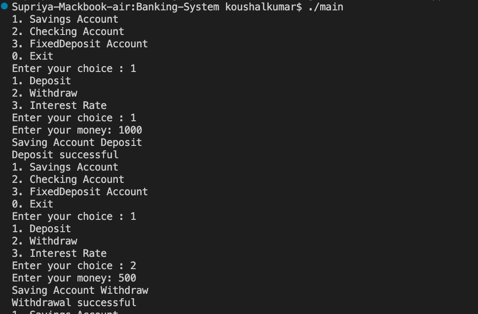

# Banking Management System Using C++

## Short Description

A menu-driven Banking Management System developed using C++. This project allows users to perform basic banking operations such as depositing money, withdrawing money, checking overdraft limits, and calculating interest for different types of bank accounts.

## About the Project

The **Banking Management System** is a console-based application developed using C++ and Object-Oriented Programming (OOP) concepts.

The project supports three types of bank accounts:

- **Savings Account:** Allows users to deposit and withdraw money and calculate savings interest.
- **Checking Account:** Allows users to check whether a withdrawal amount exceeds the available balance and overdraft limit.
- **Fixed Deposit Account:** Allows users to deposit and withdraw money and calculate fixed deposit interest.

Each account stores information such as account number, account holder name, and balance. The program uses inheritance to create specialized account types and function overriding to customize banking operations.

## Features

- Supports Savings, Checking, and Fixed Deposit accounts.
- Stores account number, account holder name, and balance.
- Validates deposit and withdrawal amounts.
- Checks the overdraft limit for Checking Accounts.
- Calculates interest for Savings and Fixed Deposit accounts.
- Uses function overriding to customize deposit and withdrawal messages.
- Provides a menu-driven interface.
- Allows users to exit the application.

## Technologies Used

* C++
* Visual Studio Code
* G++ Compiler
* Github

## C++ Concepts Used

- **Classes and Objects:** Defines bank accounts and creates account objects.
- **Encapsulation:** Keeps account data private and provides public member functions to access the balance.
- **Inheritance:** Derives `SavingsAccount`, `CheckingAccount`, and `FixedDepositAccount` from `BankAccount`.
- **Polymorphism:** Uses virtual functions and function overriding for account-specific operations.
- **Constructors:** Initializes account information when objects are created.
- **Access Specifiers:** Uses `private` and `public` to control access to class members.
- **Conditional Statements:** Uses `if`, `else if`, and `else` to validate transactions and process menu choices.
- **Loops:** Uses a `do-while` loop to display the menu repeatedly until the user exits.
- **User Input and Output:** Uses `cin` and `cout` to interact with the user.
- **Data Types:** Uses `int`, `double`, and `string` to store account information and transaction amounts.

## Requirements

* Visual Studio Code
* C++ compiler such as G++

# Installation

1. Install **VS Code**.
2. Install the **G++ compiler**.
3. Create a project folder.
4. Create a C++ file named `main.cpp`.
5. Write the program into `main.cpp`.

# How to Run

Open the VS Code terminal and run:

```bash
g++ main.cpp -o main
```

Then run the program:

```bash
./main
```

## Project Structure

```text
├── main.cpp
├── README.md
└── output.png
```

## Screenshots



## Future Improvements

- Add an option to view complete account information.
- Implement transaction history for deposits and withdrawals.
- Allow users to search for accounts by account number.
- Implement deposit and withdrawal operations for Checking Accounts.
- Restrict withdrawals from Fixed Deposit Accounts according to their term.
- Store account information permanently using file handling.
- Improve the interface with clearer transaction summaries.

## Authors

**Supriya Thakur**


   